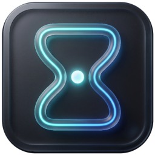
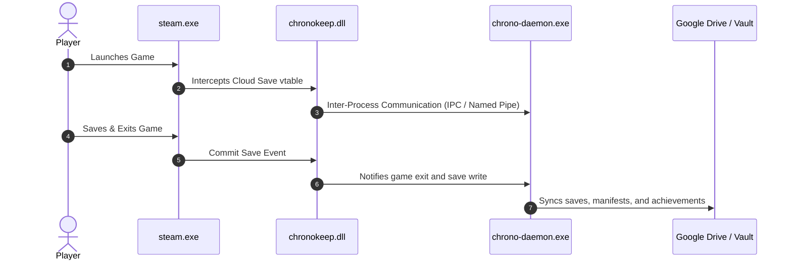

<p align="center">
  
</p>

<h1 align="center">⏱️ ChronoKeep</h1>

<p align="center">
  <strong>Clean-Room Steam Cloud Save & Achievement Synchronization and Preservation</strong><br>
  <em>Preserve your game data locally and in the cloud with speed, elegance, and zero heavyweight dependencies.</em>
</p>

<p align="center">
  <strong>English</strong> • <a href="./README.pt-BR.md">🇧🇷 Leia em Português</a>
</p>

<p align="center">
  <a href="https://github.com/leufrasiojunior/ChronoKeep/releases/latest">
    
  </a>
  <a href="https://github.com/leufrasiojunior/ChronoKeep/actions/workflows/build-and-release.yml">
    
  </a>
  <a href="./LICENSE">
    
  </a>
  <a href="https://www.rust-lang.org/">
    
  </a>
  <a href="https://tauri.app/">
    
  </a>
</p>

---

## 📑 Table of Contents

- [About the Project](#-about-the-project)
- [Key Features](#-key-features)
- [System Architecture](#-system-architecture)
- [Tech Stack](#-tech-stack)
- [Installation & Usage](#-installation--usage)
- [Building from Source](#-building-from-source)
- [Contributing](#-contributing)
- [Author](#-author)
- [License](#-license)

---

## 💡 About the Project

**ChronoKeep** is a game progress preservation suite engineered to operate transparently and non-invasively alongside the official Steam desktop client.

Game saves executed via secondary launchers, custom setups, or offline environments are often vulnerable to accidental loss during operating system reinstallations or hardware migrations. ChronoKeep resolves this through a modular **Rust** architecture, cleanly intercepting Steam save events at runtime, preserving full snapshot copies in a **Local Vault**, and automatically synchronizing everything to the cloud via **Google Drive**.

> [!IMPORTANT]
> **Clean-Room & Zero Binary Patching**: ChronoKeep never modifies Steam executable files on disk. Interception happens strictly in runtime memory through a 64-bit native MSVC ABI FFI bridge DLL.

---

## ✨ Key Features

- [x] **Google Drive Cloud Synchronization**: Automated upload and download of saves and manifests featuring native OAuth2 PKCE authentication, token encryption, and concurrency locks.
- [x] **Local Save Vault**: AppID and account-indexed save snapshots with intelligent Change Number (CN) conflict resolution.
- [x] **Fluent Design UI (Windows 11)**: Lightweight desktop application built on Tauri v2 and WebView2, with Light/Dark themes and dynamic OS preference detection.
- [x] **Achievement Visualizer & Manager**: Real-time achievement tracking and manual or automatic synchronization via Steam Web API.
- [x] **Non-Steam Game Preservation**: Transparent backup and restoration for custom games, statistics, playtime, and achievements (`stplug-in`, `lua`, `AppList`).
- [x] **Safe Isolation & Passthrough**: Automatically bypasses internal Steam service AppIDs (`760`, `7`, `241100`, `241300`), guaranteeing 100% data integrity for official games.
- [x] **Built-in Auto-Updater**: SemVer version discovery with SHA-256 binary validation and seamless one-click in-place updates.
- [x] **Internationalization (i18n)**: Out-of-the-box language support for English (`en-US`) and Portuguese (`pt-BR`).

---

## 🏗️ System Architecture

ChronoKeep is organized into 5 modular crates within a single Rust workspace:

```text
ChronoKeep/
├── crates/
│   ├── cr-gui/         --> Desktop App (Tauri v2, WebView2, Fluent Design UI)
│   ├── cr-service/     --> chrono-daemon.exe (Steam lifecycle manager & RPC engine)
│   ├── cr-bridge-dll/  --> chronokeep.dll (Native MSVC x64 FFI hook for steamclient64 vtables)
│   ├── cr-common/      --> Shared types, Google Drive client, vault and manifests
│   └── cr-proto/       --> Protocol Buffers serialization & Steam Cloud wire format
```



---

## 🛠️ Tech Stack

| Technology | Purpose |
| :--- | :--- |
|  | Core system engine, IPC, memory safety, and FFI hooking |
|  | Ultra-lightweight native desktop framework with minimal RAM footprint |
|  | Modern UI with Segoe UI Variable typography, rounded aesthetics, and Mica-style dark/light themes |
|  | Cloud storage provider for manifests and encrypted game save archives |

---

## 🚀 Installation & Usage

1. Go to the **[Releases](https://github.com/leufrasiojunior/ChronoKeep/releases/latest)** page and download the standalone `ChronoKeep.exe` or `ChronoKeep-Windows-x64.zip`.
2. Run `ChronoKeep.exe` on Windows 10 or 11 (64-bit).
3. On the main dashboard, click **"Install Bridge DLL"**:
   - The application will prompt for administrator privileges once to install the bridge DLL into the Steam directory.
4. Connect your Google Drive account under the **"Backup Destinations"** tab.
5. You're set! Compatible games will be backed up and synchronized automatically as you play.

---

## 💻 Building from Source

### Prerequisites
- **Rust Toolchain**: `stable` with target `x86_64-pc-windows-msvc`.
- **Python 3**: For packing embedded service binaries.
- **Node.js** *(optional for front-end development)*.

### Steps

```bash
# 1. Clone the repository
git clone https://github.com/leufrasiojunior/ChronoKeep.git
cd ChronoKeep

# 2. Run the release packaging script
./build_dist.sh
```

Compiled production artifacts will be placed in `dist/`:
- `ChronoKeep.exe`
- `chrono-daemon.exe`
- `chronokeep.dll`
- `cloud_redirect.dll`

---

## 🤝 Contributing

Contributions are welcome! To contribute to ChronoKeep:

1. **Fork** the repository.
2. Create a feature branch branching from `develop`:
   ```bash
   git checkout -b feature/my-new-feature develop
   ```
3. Commit your changes:
   ```bash
   git commit -m "feat: add support for ..."
   ```
4. Push your branch to your fork:
   ```bash
   git push origin feature/my-new-feature
   ```
5. Open a **Pull Request** targeting the `develop` branch.

---

## 👤 Author

**Leufrasio Junior**
- GitHub: [@leufrasiojunior](https://github.com/leufrasiojunior)

---

## 📄 License

This project is licensed under the **MIT License**. See the [LICENSE](./LICENSE) file for details.
