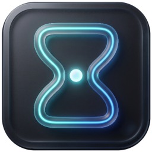
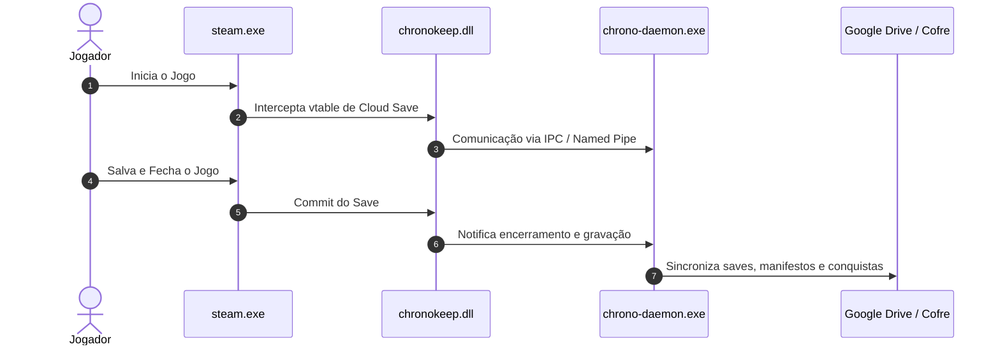

<p align="center">
  
</p>

<h1 align="center">⏱️ ChronoKeep</h1>

<p align="center">
  <strong>Sincronização e Preservação de Saves e Conquistas Steam Cloud Clean-Room</strong><br>
  <em>Preserve seus dados de jogos localmente e na nuvem com elegância, velocidade e zero dependências pesadas.</em>
</p>

<p align="center">
  <a href="./README.md">🇺🇸 Read in English</a> • <strong>🇧🇷 Português (Brasil)</strong>
</p>

<p align="center">
  <a href="https://github.com/leufrasiojunior/ChronoKeep/releases/latest">
    
  </a>
  <a href="https://github.com/leufrasiojunior/ChronoKeep/actions/workflows/build-and-release.yml">
    
  </a>
  <a href="./LICENSE">
    
  </a>
  <a href="https://www.rust-lang.org/">
    
  </a>
  <a href="https://tauri.app/">
    
  </a>
</p>

---

## 📑 Sumário

- [Sobre o Projeto](#-sobre-o-projeto)
- [Principais Funcionalidades](#-principais-funcionalidades)
- [Arquitetura do Ecossistema](#-arquitetura-do-ecossistema)
- [Tecnologias Utilizadas](#-tecnologias-utilizadas)
- [Como Instalar e Usar](#-como-instalar-e-usar)
- [Como Compilar do Código-Fonte](#-como-compilar-do-código-fonte)
- [Como Contribuir](#-como-contribuir)
- [Autor](#-autor)
- [Licença](#-licença)

---

## 💡 Sobre o Projeto

O **ChronoKeep** é uma ferramenta de preservação de progresso de jogos projetada para agir de forma transparente e não-invasiva com o cliente Steam oficial.

Originalmente, saves de jogos executados via launchers secundários ou integrações personalizadas podem ser perdidos durante reinstalações de sistema ou transições de hardware. O ChronoKeep soluciona esse problema através de uma arquitetura modular em **Rust**, interceptando de forma limpa as chamadas de salvamento do Steam em tempo de execução, preservando cópias integrais no **Cofre Local** e sincronizando automaticamente na nuvem via **Google Drive**.

> [!IMPORTANT]
> **Clean-Room & Sem Modificação de Binários**: O ChronoKeep não altera arquivos executáveis do Steam no disco. A interceptação ocorre em tempo de execução através de bridge DLL FFI com ABI x64 nativa.

---

## ✨ Principais Funcionalidades

- [x] **Sincronização na Nuvem com Google Drive**: Upload e download automatizado de saves e manifestos com autenticação OAuth2 PKCE nativa e travas de concorrência.
- [x] **Cofre Local de Saves (Local Vault)**: Preservação de snapshots de saves organizados por AppID e conta, com resolução inteligente de conflitos por Change Number (CN).
- [x] **Interface Fluent Design (Windows 11)**: Desenvolvida com Tauri v2, WebView2 e suporte a temas Claro, Escuro e detecção dinâmica do sistema operacional.
- [x] **Visualizador e Gerenciador de Conquistas**: Acompanhamento de progresso de conquistas via Steam Web API com sincronização manual ou automática.
- [x] **Sincronização de Jogos Não-Steam**: Backup e restore transparente de estatísticas, tempo de jogo e conquistas de jogos customizados (`stplug-in`, `lua`, `AppList`).
- [x] **Isolamento e Passthrough Seguro**: Ignora automaticamente AppIDs internos do Steam (`760`, `7`, `241100`, `241300`), garantindo 100% de integridade aos jogos oficiais.
- [x] **Atualizador Automático Embutido**: Verificação de novas versões via SemVer com verificação de integridade SHA-256 e aplicação com um clique.
- [x] **Internacionalização (i18n)**: Suporte nativo completo para Português (`pt-BR`) e Inglês (`en-US`).

---

## 🏗️ Arquitetura do Ecossistema

O ChronoKeep é composto por 5 crates modulares em um único workspace Rust:

```text
ChronoKeep/
├── crates/
│   ├── cr-gui/         --> Aplicação Desktop (Tauri v2, WebView2, UI Fluent Design)
│   ├── cr-service/     --> chrono-daemon.exe (Gerenciador de ciclo de vida Steam & RPC)
│   ├── cr-bridge-dll/  --> chronokeep.dll (Hook FFI MSVC x64 das vtables steamclient64)
│   ├── cr-common/      --> Tipos compartilhados, cliente Google Drive, cofre e manifestos
│   └── cr-proto/       --> Serialização Protocol Buffers e buffers Steam Cloud
```



---

## 🛠️ Tecnologias Utilizadas

| Tecnologia | Finalidade |
| :--- | :--- |
|  | Core do sistema, IPC, memória segura e manipulação FFI |
|  | Framework desktop nativo leve e seguro com consumo mínimo de memória |
|  | Interface gráfica com Segoe UI Variable, cantos arredondados e temas Fluent |
|  | Provedor de armazenamento em nuvem para manifestos e saves criptografados |

---

## 🚀 Como Instalar e Usar

1. Acesse a página de **[Releases](https://github.com/leufrasiojunior/ChronoKeep/releases/latest)** e baixe o executável autônomo `ChronoKeep.exe` ou o arquivo `ChronoKeep-Windows-x64.zip`.
2. Execute o `ChronoKeep.exe` no Windows 10 ou 11 (64-bits).
3. Na tela inicial, clique em **"Instalar Bridge DLL"**:
   - O aplicativo solicitará permissão de administrador uma única vez para instalar a DLL no diretório do Steam.
4. Conecte sua conta do Google Drive na aba **"Destinos de Backup"**.
5. Pronto! Seus jogos compatíveis serão sincronizados automaticamente sempre que você jogar.

---

## 💻 Como Compilar do Código-Fonte

### Pré-requisitos
- **Rust Toolchain**: `stable` com target `x86_64-pc-windows-msvc`.
- **Python 3**: Para empacotamento dos binários embutidos de proteção de antivírus.
- **Node.js** *(opcional caso use ferramentas adicionais de UI)*.

### Passo a Passo

```bash
# 1. Clonar o repositório
git clone https://github.com/leufrasiojunior/ChronoKeep.git
cd ChronoKeep

# 2. Executar o build completo de release
./build_dist.sh
```

Os binários finais compilados e prontos para distribuição estarão na pasta `dist/`:
- `ChronoKeep.exe`
- `chrono-daemon.exe`
- `chronokeep.dll`
- `cloud_redirect.dll`

---

## 🤝 Como Contribuir

Contribuições são muito bem-vindas! Para contribuir com o ChronoKeep:

1. Faça um **Fork** do projeto.
2. Crie uma branch para sua funcionalidade partindo de `develop`:
   ```bash
   git checkout -b feature/minha-nova-funcionalidade develop
   ```
3. Faça o commit das suas alterações:
   ```bash
   git commit -m "feat: adiciona suporte a ..."
   ```
4. Envie a branch para o seu Fork:
   ```bash
   git push origin feature/minha-nova-funcionalidade
   ```
5. Abra um **Pull Request** para a branch `develop`.

---

## 👤 Autor

**Leufrasio Junior**
- GitHub: [@leufrasiojunior](https://github.com/leufrasiojunior)

---

## 📄 Licença

Este projeto é distribuído sob a licença **MIT**. Consulte o arquivo [LICENSE](./LICENSE) para mais detalhes.
